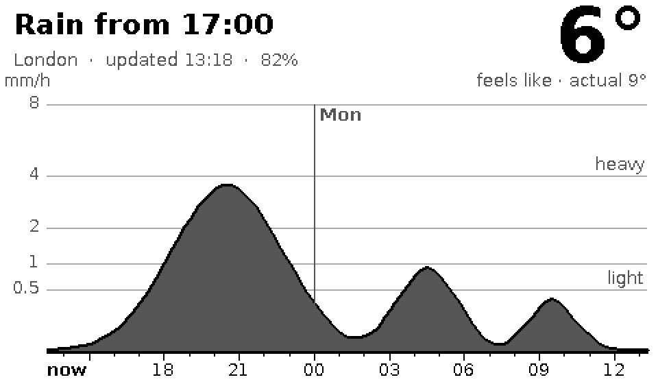

# raindash-solar

A 24-hour rain forecast on a 3.7" e-paper display, for leaving on a window sill. A Raspberry Pi Pico W runs it from an 18650 cell that a small solar panel keeps topped up. No server needed.

Sister project of [raindash-kindle](https://github.com/amiablealex/raindash-kindle): same chart and wording, built from hobbyist parts.



## How it works

Every ~30 minutes a TPL5110 power timer switches the Pico on. It joins Wi-Fi, fetches the Met Office forecast from Open-Meteo, draws the chart, then tells the timer to cut its power completely. One update takes about 10 s and 0.2 mAh. With the power off in between, it uses roughly 10 mAh a day, so a charged cell lasts months even without sun.

- **On USB power** it stays on and updates every 30 minutes instead. A phone charger is a fine mains option, and this is also how you configure it.
- **Low battery** turns the status line into a black "charge me" bar. If the cell runs flat it shows "Please charge me" (which stays on the e-paper with no power), stops using Wi-Fi, and starts again once charged.
- **No connection:** the last chart stays up. After three failed updates it's redrawn with "offline", and retries slow down to save the battery.
- **Several Wi-Fi networks**, each with its own location. Take it to another house and it shows that town.
- **Optional heartbeat** to a URL of your choice (Home Assistant, healthchecks.io, your own server), and a small status page for your devices (`server/`).

## Hardware

Pico W, Waveshare Pico-ePaper-3.7, 18650 cell, protected TP4056 charger (USB-C), Adafruit TPL5110, a 6 V solar panel, two Schottky diodes. Parts list and wiring: [hardware/](hardware/README.md).

## Install

1. Install MicroPython 1.29 on the Pico W. In Thonny: Tools > Options > Interpreter > Install or update MicroPython.
2. Download the latest release zip and copy everything in its `pico/` folder onto the Pico (Thonny's Files pane > Upload to /).
3. Copy `config.example.json` to `config.json` on the Pico and fill in your Wi-Fi and location. All settings are explained in [CONFIG.md](CONFIG.md).
4. Press Ctrl+D in Thonny, or power-cycle it.

## Looking after it

- **Charging:** plug any USB-C phone charger into the charging port.
- **Refresh now:** press the button on the timer.
- **Changing settings:** plug the Pico's micro-USB into a computer. It starts in USB mode. Press Stop in Thonny and edit `config.json`.
- **Updating:** copy the new release files over the old ones.

## Building from source

```
pip install "mpy-cross==1.29.*"
python tools/build.py          # -> dist/pico/ and dist/raindash-solar-<version>.zip
```

`raindash.py` ships precompiled because compiling it on the Pico needs more RAM than it has spare. Never leave a `raindash.py` on the Pico next to `raindash.mpy`: MicroPython loads the `.py` first. `tools/` also has `tpltest.py` and `tplwatch.py` for checking a TPL5110, and `make_fonts.sh` for rebuilding the fonts.

## Credits

Forecast data: [Open-Meteo](https://open-meteo.com) (UK Met Office models), CC BY 4.0. Display driver adapted from [Waveshare's Pico_ePaper_Code](https://github.com/waveshare/Pico_ePaper_Code) (MIT). Fonts: DejaVu Sans, converted with [font_to_py](https://github.com/peterhinch/micropython-font-to-py).

MIT licence.
